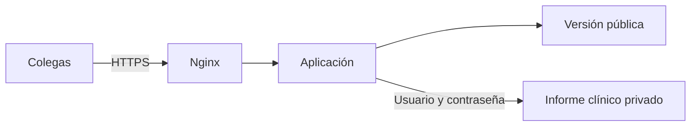

# Cómo compartir RERIMSS

Ya están generadas dos versiones con el nuevo Excel censal.

| Versión | Qué pueden ver | Cómo se comparte |
| --- | --- | --- |
| Pública | Mapas por AGEB, resultados agregados, conteos protegidos y redondeados | El archivo HTML público, su ZIP o el enlace principal cuando se instale |
| Privada | Puntos y fichas clínicas; periodos anuales y resultados exactos del informe | Un enlace que solicita usuario y contraseña |

**Para compartir hoy la pública:** envía `RERIMSS-publico.zip`. Incluye el HTML autocontenido y no contiene la versión clínica. También puedes entregarlo al administrador para alojarlo como un sitio estático.

**Para compartirla desde GitHub:** el proyecto incluye el sitio público en `docs/` y su workflow de GitHub Pages. Sigue [GUIA-GITHUB.md](GUIA-GITHUB.md) para activarlo y obtener el enlace de un despliegue terminado. GitHub Pages aloja la pública; la privada requiere el servidor institucional.

Ambas versiones usan CARTO Positron como fondo y permiten explorar los mapas de forma interactiva. Los resultados y polígonos están incorporados; el fondo requiere acceso a CARTO desde el navegador.

**Para compartir la privada mediante un enlace:** entrega `RERIMSS-aplicacion-PRIVADA.zip` solamente al administrador del servidor institucional. Ese paquete contiene información clínica y no debe colocarse en una carpeta pública. Incluye la aplicación que comprueba el inicio de sesión antes de servir el informe.

## Qué son Docker y Nginx

Docker empaqueta la aplicación con lo necesario para ejecutarla. Nginx recibe las visitas y utiliza el certificado HTTPS de la institución. La aplicación decide si muestra la página pública o solicita una cuenta para entrar a la privada.

## Qué debes pedir al administrador

1. Un subdominio institucional para el estudio.
2. Un servidor con Docker Compose y puertos disponibles para HTTPS.
3. El certificado y la clave HTTPS instalados en el servidor; no es necesario enviarlos por chat.
4. Instalar el paquete siguiendo `GUIA-SERVIDOR.md` y crear una cuenta por colega autorizado.

Después de instalarlo, tus colegas utilizarán el enlace principal para la pública y el mismo dominio con `/privado/` para la clínica. No necesitan instalar R, Excel, Docker ni otro programa.

La aplicación está probada localmente con Docker, Nginx y HTTPS. Todavía no se ha instalado en el servidor institucional: falta su dominio y el acceso del administrador para hacerlo.
